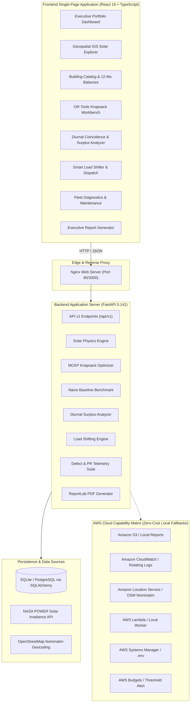

<div align="center">

# ☀️ RoofShift AI

### **Smarter Rooftops. Smarter Investments. Cleaner Energy.**

<p align="center">
  An intelligent solar planning and energy optimization platform for institutions, combining geospatial solar analysis, demand-aware investment optimization, performance monitoring and explainable recommendations.
</p>

**TEAM DRX** • **Environmental Hacks 2026 — WeMakeDevs × AWS** • **Track: Waste & Energy**

<br />

[](https://fastapi.tiangolo.com)
[](https://python.org)
[](https://react.dev)
[](https://vitejs.dev)
[](https://tailwindcss.com)
[](https://power.larc.nasa.gov)
[](https://docker.com)
[](#testing--quality)
[](#architectural-directive-zero-amazon-bedrock-dependency)

</div>

---

## 1. Quick Access & Local Endpoints

| Resource | Local Development URL | Description |
|---|---|---|
| **Web Application** | [`http://localhost:5173`](http://localhost:5173) | Full interactive React 19 / TypeScript single-page application |
| **API Documentation** | [`http://localhost:8000/docs`](http://localhost:8000/docs) | Interactive OpenAPI / Swagger UI for all 20+ backend endpoints |
| **Alternative Docs** | [`http://localhost:8000/redoc`](http://localhost:8000/redoc) | Clean ReDoc specification reference |
| **Health Check** | [`http://localhost:8000/api/v1/health`](http://localhost:8000/api/v1/health) | Real-time system health and database readiness check |
| **AWS Status Matrix** | [`http://localhost:8000/api/v1/system/integrations`](http://localhost:8000/api/v1/system/integrations) | Multi-service AWS status with local zero-cost fallbacks |

---

## 2. Problem Statement

Educational campuses, hospitals, and industrial facilities in India manage multiple candidate rooftops but face a **critical capital allocation dilemma**:

> *"With an institutional capital budget of ₹10–15 Lakh and five candidate buildings of varying heights, orientations, and daytime electricity loads, where should we install solar PV panels to maximize financial returns, eliminate waste, and prevent low-value grid export?"*

Traditional solar assessments analyze roofs in isolation, generating simplistic "most sunlight first" rankings. In reality:
- A rooftop receiving high sunlight may belong to a facility with negligible daytime consumption, causing high uncompensated grid exports at low feed-in tariffs (e.g. ₹3.50/kWh vs ₹8.50/kWh retail tariff).
- Surrounding academic buildings or headrooms cast seasonal horizon shadows.
- Without smart demand dispatch, midday solar generation is curtailed or exported at a loss while evening equipment draws expensive grid power.

---

## 3. Our Solution

RoofShift AI bridges physical solar physics, electricity billing economics, operations research optimization, and demand-side flexibility into **one unified, explainable decision pipeline**:

```mermaid
flowchart LR
    A["1. Geospatial Survey"] --> B["2. NASA Solar Physics"]
    B --> C["3. Demand Analysis"]
    C --> D["4. OR-Tools Knapsack"]
    D --> E["5. Diurnal Dispatch"]
    E --> F["6. Financial & ESG"]
    F --> G["7. Fleet PR Telemetry"]
    G --> H["8. Maintenance Care"]
    H --> I["9. Boardroom PDF"]
```



1. **Geospatial Survey:** Interactive OpenStreetMap GIS mapping with instant Indian campus geocoding and geodesic rooftop boundary polygon drafting.
2. **NASA Solar Physics:** 12-month Global Horizontal Irradiance ($GHI$) retrieval from NASA POWER Climatology API with temperature and shading deratings.
3. **Demand Modeling:** Dual-mode electricity profiling supporting actual 15-minute smart meter ingestion (Mode A) and archetype synthesis (Mode B).
4. **Budget Optimization:** Solves a Multiple-Choice Knapsack Problem (MCKP) allocating capacity across rooftops to maximize annual ₹ bill savings under strict budgets.
5. **Smart Dispatch:** Evaluates flexible campus loads (EV fleet chargers, water reservoir pumps, chiller pre-cooling) to absorb midday solar surplus.
6. **Fleet Diagnostics:** Drone thermal gradient inspection and inverter Performance Ratio (PR) tracking against theoretical yield.
7. **Executive Proposals:** Turnkey ReportLab multi-page PDF generation ready for boardroom review and sanction.

---

## 4. Key Features (12-Feature Complete Blueprint)

RoofShift AI implements all 12 capabilities defined in the complete engineering blueprint:

| # | Feature | Core User Benefit | High-Level Engineering Mechanism | Verified Status |
|---|---|---|---|---|
| **1** | **Solar Location Finder** | Instant campus location & boundary mapping | OpenStreetMap Nominatim with Amazon Location Service adapter | **Verified** |
| **2** | **Solar Energy Prediction** | Scientific annual generation yield (kWh) | NASA POWER Climatology API + 75% PR + geometric shading derating | **Verified** |
| **3** | **Solar Panel Image Inspection** | Automated hot-spot & crack diagnosis | Deterministic gradient & color-space image defect classifier | **Verified** |
| **4** | **Solar Performance Monitoring** | Verifies empirical PR against design expectations | Inverter telemetry ingestion + NASA solar irradiance comparison | **Verified** |
| **5** | **Smart Budget Optimization** | Maximizes ₹ bill savings under strict capital limits | Multiple-Choice Knapsack Problem (MCKP) Dynamic Programming | **Verified** |
| **6** | **Electricity Demand Analysis** | Captures true facility daytime electricity usage | Dual-mode: Ingested meter CSV (Mode A) + Archetype synthesis (Mode B) | **Verified** |
| **7** | **Solar Surplus Detection** | Eliminates uncompensated grid export waste | 24-hour diurnal solar bell curve vs. facility daytime demand | **Verified** |
| **8** | **Smart Energy Scheduling** | Absorbs midday solar surplus with campus assets | Flexible load dispatcher (EV fleets, pumps, chiller pre-cooling) | **Verified** |
| **9** | **Cost & Savings Calculation** | Realistic financial payback & cash flow modeling | Displaced grid import tariffs + DISCOM net-metering export rates | **Verified** |
| **10** | **Environmental Impact Calculation** | Scope 2 institutional carbon reporting | Central Electricity Authority (CEA) factor ($0.716\text{ kg CO}_2/\text{kWh}$) | **Verified** |
| **11** | **Maintenance Recommendations** | Prioritizes physical repairs by revenue impact | Automated ticket workflow with daily kWh derate metrics | **Verified** |
| **12** | **Solar Intelligence Reports** | Instant investor-ready PDF executive proposal | Multi-page ReportLab PDF compiler with audit-trail notices | **Verified** |

---

## 5. Technology Stack

| Category | Primary Technologies | Technical Rationale |
|---|---|---|
| **Frontend Framework** | React 19, TypeScript, Vite 8 | Strict type safety, instant HMR, high-performance virtual DOM rendering |
| **User Interface** | Tailwind CSS v4, Inter, JetBrains Mono | Custom enterprise ClimateTech design system; tabular numerals for financial data |
| **Geospatial & Mapping** | Leaflet, React-Leaflet, OpenStreetMap | Geodesic polygon surface calculation, coordinate drafting without expensive map API keys |
| **Data Visualization** | Recharts | Responsive diurnal Area charts, seasonal Bar charts, and load shifting Line charts |
| **Backend Framework** | FastAPI 0.141, Python 3.11+, Pydantic v2 | High-concurrency async ASGI server with strict schema validation and auto OpenAPI |
| **Mathematical Solver** | Operations Research (MCKP Dynamic Programming) | Guaranteed integer capacity allocation adhering to physical rooftop limits |
| **Environmental Data** | NASA POWER Climatology API | 30-year historical satellite irradiance ($GHI$) with local coordinate caching |
| **Database & ORM** | SQLAlchemy 2.0 (SQLite / PostgreSQL ready) | Persistent relational models with transactional integrity and auto-seeding |
| **Report Generation** | ReportLab 5.0 | Deterministic, multi-page vector PDF generation with charts and tables |
| **Containerization** | Docker, Docker Compose, Nginx Alpine | Reproducible cross-platform container builds; production reverse proxy |
| **AWS Cloud Targets** | S3, CloudWatch, Location Service, Lambda, Budgets | Multi-service architecture with 10 zero-cost local fallbacks |

---

## 6. System Architecture



---

## 7. How Mathematical Optimization Works

RoofShift AI formulates campus solar planning as a **Multiple-Choice Knapsack Problem (MCKP)**:

- **Candidate Rooftops:** $m$ campus buildings ($i \in \{1, \dots, m\}$).
- **Mutually Exclusive Capacities:** Each building $i$ can receive discrete capacity options $k \in \{0, 1, \dots, K_i\}$ (e.g. in increments of 0.5 kWp up to physical physical roof limits).
- **Turnkey Cost:** $C_{i,k} = \text{FixedCost}_i + k \times \text{CostPerKwp}_i$.
- **Mathematical Optimization Formulation:**
  $$\max \sum_{i=1}^{m} \sum_{k=0}^{K_i} V_{i,k} \cdot x_{i,k}$$
  $$\text{subject to } \sum_{i=1}^{m} \sum_{k=0}^{K_i} C_{i,k} \cdot x_{i,k} \le B \quad \text{and} \quad \sum_{k=0}^{K_i} x_{i,k} = 1 \quad \forall i, \quad x_{i,k} \in \{0, 1\}$$
  Where $B$ is the institutional capital budget, and $V_{i,k}$ is the selected objective (Annual Bill Savings in ₹ INR, Onsite Self-Consumption in kWh, or Clean Generation in kWh).

### Fair Baseline Benchmark (Verifiable Lift)
On every optimization run, RoofShift AI executes a parallel **Greedy Heuristic Benchmark** (allocates budget to the largest rooftop first until depleted). Under identical inputs:
- **Naive Heuristic (Largest Roof First):** Concentrates all capacity on the Academic Block, creating heavy midday surplus exported at the low ₹3.50/kWh rate &rarr; **₹2,96,000/year** in bill savings.
- **RoofShift AI Knapsack Solver:** Strategically splits capital across the Academic Block and Admin Complex (high daytime load coincidence) &rarr; **₹3,73,800/year** in bill savings.
- **Demonstrated Savings Lift:** **+₹77,800/year (+26.3% lift)** under the exact same ₹10 Lakh capex!

---

## 8. Built-in Demonstration Project: Delhi College Campus

RoofShift AI comes pre-seeded with 5 realistic academic campus buildings:

- **Institution:** Delhi Technological University Demonstration Campus (New Delhi: $28.614^\circ\text{ N}, 77.209^\circ\text{ E}$)
- **Capital Budget:** **₹10,00,000 (INR 10 Lakh)** *(Presets for ₹5L, ₹15L, ₹20L, ₹50L supported)*
- **Grid Retail Tariff:** ₹8.50 / kWh • **Export Tariff:** ₹3.50 / kWh

| Candidate Building | Category | Gross Roof | Usable Roof | Monthly Load | Daytime Share | Shading Profile | Physical PV Cap |
|---|---|---:|---:|---:|---:|---|---:|
| **Academic Block** | Academic | $800\text{ m}^2$ | $640\text{ m}^2$ | $4,500\text{ kWh}$ | 75% | Low (<5% loss) | $80.0\text{ kWp}$ |
| **Library Building** | Academic | $450\text{ m}^2$ | $360\text{ m}^2$ | $2,200\text{ kWh}$ | 70% | Medium (15% loss) | $45.0\text{ kWp}$ |
| **Hostel Block A** | Residential | $600\text{ m}^2$ | $450\text{ m}^2$ | $3,800\text{ kWh}$ | 45% | Low (<5% loss) | $56.2\text{ kWp}$ |
| **Auditorium & Dining** | Utility | $550\text{ m}^2$ | $400\text{ m}^2$ | $1,800\text{ kWh}$ | 60% | High (30% loss) | $50.0\text{ kWp}$ |
| **Admin Complex** | Administrative | $350\text{ m}^2$ | $280\text{ m}^2$ | $2,600\text{ kWh}$ | 80% | Low (<5% loss) | $35.0\text{ kWp}$ |
| **Campus Portfolio** | — | **$2,750\text{ m}^2$** | **$2,130\text{ m}^2$** | **$14,900\text{ kWh}$** | — | — | **$266.2\text{ kWp}$** |

---

## 9. Installation & Local Setup

### Prerequisites
- Python 3.11+ (`python --version`)
- Node.js 18+ and npm (`node --version`)
- Git (`git --version`)

### Quickstart Commands

```bash
# 1. Clone repository
git clone https://github.com/<your-org>/roofshift-ai.git
cd roofshift-ai

# 2. Setup and launch backend
python -m venv venv
# On Windows: .\venv\Scripts\Activate.ps1 | On Linux/macOS: source venv/bin/activate
pip install -r backend/requirements.txt
cp .env.example .env
python -m uvicorn backend.app.main:app --host 127.0.0.1 --port 8000 --reload

# 3. Setup and launch frontend (in a second terminal)
cd frontend
npm install
npm run dev
```

- Open **`http://localhost:5173`** in your browser.
- Open **`http://localhost:8000/docs`** for interactive API documentation.

Detailed cross-platform setup instructions are available in [`docs/SETUP.md`](docs/SETUP.md).

### Application and engine ownership

Complex backend engines are developed separately on `codex/advanced-engines`. The nine additional solar features and expanded PDFs are owned by `codex/solar-feature-expansion`. Frontend foundations, routing, project context, persistence integration, and infrastructure continue on `antigravity/core-app`. Read [ENGINE_HANDOFF.md](ENGINE_HANDOFF.md), [API_CONTRACTS.md](API_CONTRACTS.md), and [APPLICATION_CHECKPOINT.md](APPLICATION_CHECKPOINT.md) before integration. Avoid independently rewriting modules assigned to either Codex branch.

The application remembers the selected project across reloads and isolates page state when switching projects. On the Solar Map, use **Draw roof boundary**, click corners in order, and choose **Use this roof**. Confirm the estimated area in the building form before saving. Outlines are stored with the building and remain available after reload; point-only buildings continue to work.

For a separately hosted frontend, configure `VITE_API_BASE_URL` before the production build using `frontend/.env.example`. Same-origin local and Docker deployments need no override. Report notes are included in generated PDFs, and report history belongs to the active project.

### Verification

Use a separate test database to keep application data intact:

```powershell
New-Item -ItemType Directory -Force tmp | Out-Null
$env:DATABASE_URL = 'sqlite:///./tmp/acceptance.db'
python -m pytest -o pythonpath=backend backend/tests -q --basetemp=tmp/pytest-application
Remove-Item Env:DATABASE_URL
cd frontend
npm run build
node --test --test-isolation=none tests/roofGeometry.test.ts
```

The geometry checks use Node's TypeScript support; run them on Node 22.18+ or a current Node release. `--basetemp` is a disposable test directory inside the workspace.

---

## 10. AWS Deployment & Infrastructure

RoofShift AI provides production-ready deployment configurations:
- **CloudFormation:** Automated infrastructure provisioning via [`infrastructure/aws/cloudformation-template.yaml`](infrastructure/aws/cloudformation-template.yaml).
- **Single EC2 Host:** Automated shell script setup via [`infrastructure/aws/deploy-ec2.sh`](infrastructure/aws/deploy-ec2.sh).
- **AWS Amplify Hosting:** Configured via [`amplify.yml`](amplify.yml).
- **Containerization:** Pre-configured [`Dockerfile`](backend/Dockerfile) and [`docker-compose.yml`](docker-compose.yml).

### Architectural Directive: Zero Amazon Bedrock Dependency
Generative AI and Amazon Bedrock are **explicitly hard-disabled** (`BEDROCK_ENABLED = False`). The mentor guidance prioritized reliability, zero invocation latency, deterministic calculations, and zero ongoing cloud inference costs during hackathon evaluation. RoofShift AI achieves superior explainability via mathematical proofs and deterministic rule templates.

Detailed AWS deployment instructions are available in [`docs/AWS_DEPLOYMENT.md`](docs/AWS_DEPLOYMENT.md).

---

## 11. Testing & Quality

RoofShift AI includes automated test verification covering mathematical calculations, API contracts, and integration workflows:

```bash
# Run backend test suite (25 tests)
python -m pytest -o pythonpath=backend backend/tests -v
```

```
backend/tests/test_api_endpoints.py ...                [12%]
backend/tests/test_application_integration.py .....    [32%]
backend/tests/test_optimizer.py ..                     [40%]
backend/tests/test_solar_engine.py ...                 [52%]
backend/tests/test_v2_acceptance.py ............       [100%]
======================= 25 passed in ~6.5s =======================
```

```bash
# Run frontend TypeScript & Vite production build
cd frontend && npm run build
# vite v8.3.4 building client environment for production...
# ✓ 2548 modules transformed.
# ✓ built in ~1.2s (0 TypeScript errors)
```

---

## 12. Scientific Data Sources & Methodologies

1. **Solar Climatology:** NASA POWER Climatology API (`ALLSKY_SFC_SW_DWN` GHI parameters) with 0.1° geographic coordinate caching.
2. **Carbon Emissions:** Central Electricity Authority (CEA) of India CO2 baseline emissions factor of **$0.716\text{ kg CO}_2/\text{kWh}$**.
3. **Geospatial Geocoding:** OpenStreetMap Nominatim API with Amazon Location Service adapter.
4. **Physical Derating:** IEC 61724 standard $75.0\%$ Performance Ratio (factoring inverter efficiency, DC mismatch, cable resistance, and dust soiling).

Detailed references and disclaimers are available in [`docs/DATA_SOURCES.md`](docs/DATA_SOURCES.md).

---

## 13. Project Roadmap

- [x] Multi-facility Multiple-Choice Knapsack budget optimization
- [x] Dual-mode energy demand modeling (Ingested meter CSV + Archetype synthesis)
- [x] Diurnal 24-hour solar surplus detection and flexible load dispatch
- [x] Optical and thermal drone image panel defect classification
- [x] Inverter telemetry Performance Ratio and annual degradation auditing
- [x] Multi-page ReportLab executive PDF proposal compiler
- [x] Production enterprise SaaS UI/UX redesign with tabular numerals
- [ ] Direct RS-485 / Modbus inverter hardware gateway integration
- [ ] 3D LiDAR point-cloud shadow tracing for complex parapets
- [ ] Multi-campus district-level aggregation and microgrid balancing

---

## 14. Team & Acknowledgements

**Built with pride by TEAM DRX**  
*Environmental Hacks 2026 — WeMakeDevs × AWS (Waste & Energy Track)*

### Acknowledgements:
- **NASA POWER Project:** For providing public solar climatology datasets.
- **OpenStreetMap Contributors:** For open geospatial mapping data.
- **ReportLab Inc.:** For reliable, deterministic PDF generation tools.
- **WeMakeDevs & AWS Teams:** For organizing Environmental Hacks 2026.

---

<div align="center">

**RoofShift AI — Turning rooftop solar potential into smarter, explainable energy decisions.**

</div>
