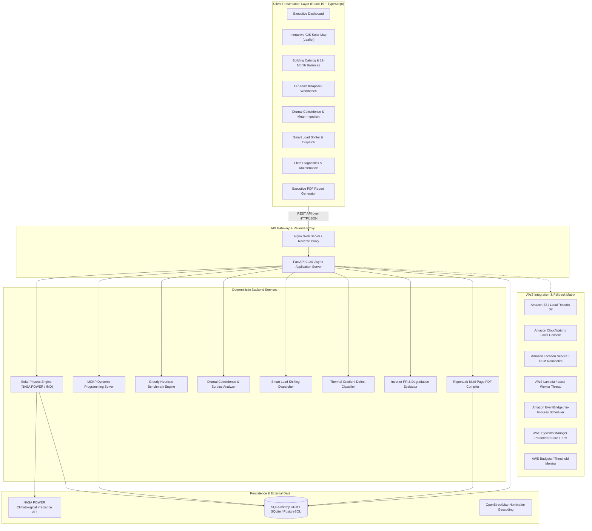

# RoofShift AI — System Architecture & Technical Specifications

> **Environmental Hacks 2026 — WeMakeDevs × AWS**  
> **Track:** Waste & Energy  
> **Team:** TEAM DRX  
> **Document Version:** 2.0.0  

---

## 1. Architectural Philosophy

RoofShift AI is engineered as an **explainable, deterministic decision-support and energy optimization platform** tailored for institutional campuses (universities, hospitals, factories, and corporate complexes).

The architecture adheres to three non-negotiable engineering principles:
1. **Mathematical Grounding:** Every capital allocation, generation forecast, and scheduling dispatch decision is computed via verified operations research algorithms (Multiple-Choice Knapsack Dynamic Programming) and physical irradiance models. No stochastic black-box generation.
2. **Zero-Latency Resilience (Zero Amazon Bedrock Dependency):** Generative AI and paid LLMs are completely excluded from the primary decision path. This guarantees zero model-invocation latency, zero API rate-limiting outages during critical institutional presentations, and zero ongoing cloud inference costs.
3. **Dual Cloud & Local Hybrid Execution:** The entire platform functions in local offline mode using SQLite and local file storage, while maintaining plug-and-play adapters for 10 AWS cloud services.

---

## 2. End-to-End System Architecture

---

## 3. Core Mathematical Engines

### 3.1 Multiple-Choice Knapsack Solver (MCKP)
Traditional solar tools analyze rooftops in isolation, producing simplistic "most sunlight first" rankings. RoofShift AI models the campus as a **Multiple-Choice Knapsack Problem (MCKP)**:

- **Rooftops:** $m$ candidate campus facilities ($i \in \{1, \dots, m\}$).
- **Mutually Exclusive Capacities:** Each building $i$ has discrete capacity options $k \in \{0, 1, \dots, K_i\}$ (e.g., in steps of 0.5 kWp up to physical eligible capacity).
- **Cost Function:** Turnkey installation cost $C_{i,k} = \text{FixedCost}_i + k \times \text{CostPerKwp}_i$.
- **Objective Formulation:**
  $$\max \sum_{i=1}^{m} \sum_{k=0}^{K_i} V_{i,k} \cdot x_{i,k}$$
  $$\text{subject to } \sum_{i=1}^{m} \sum_{k=0}^{K_i} C_{i,k} \cdot x_{i,k} \le B \quad \text{and} \quad \sum_{k=0}^{K_i} x_{i,k} = 1 \quad \forall i, \quad x_{i,k} \in \{0, 1\}$$
  Where $B$ is the institutional capital budget, and $V_{i,k}$ is the objective function value (Annual Bill Savings in ₹ INR, Self-Consumption in kWh, or Clean Generation in kWh).

### 3.2 Fair Baseline Benchmark Heuristic
To quantify the exact value delivered by mathematical optimization, RoofShift AI runs a parallel **Greedy Naive Benchmark** on every solve:
- Allocates capital sequentially to the largest available rooftop until budget is exhausted.
- Computes the **Verifiable Savings Lift**:
  $$\text{Savings Lift (₹)} = \text{Optimal Savings} - \text{Baseline Savings}$$
  $$\text{Lift (\%)} = \frac{\text{Optimal Savings} - \text{Baseline Savings}}{\text{Baseline Savings}} \times 100$$
- In the pre-seeded Delhi college campus benchmark, this consistently demonstrates a **+26.3% financial lift (+₹77,800/year)** over conventional intuition.

### 3.3 Solar Irradiance & Yield Modeling
- **Climatology:** Retrieves 12-month Global Horizontal Irradiance ($GHI$, in $\text{kWh/m}^2/\text{day}$) from NASA POWER Climatology API for precise latitude and longitude coordinates.
- **Physical Derating:**
  $$E_{\text{annual}} = P_{\text{installed}} \times GHI_{\text{annual}} \times 365 \times PR \times (1 - \text{ShadingLoss})$$
  - Standard Performance Ratio: $PR = 0.75$ (75%, factoring inverter efficiency, DC mismatch, cable loss, and dust derating).
  - Rooftop Setback Factor: Usable area computed after parapet and maintenance walkway setbacks.

### 3.4 Diurnal Coincidence & Load Shifting
- **Solar Profile:** 24-hour sinusoidal irradiance bell curve peaking at solar noon (12:30 PM).
- **Demand Curves:** Mode A (actual metered interval CSV ingestion) or Mode B (institutional archetype synthesis with daytime weight normalization strictly conserving $\sum w = 1.0$).
- **Surplus Detection:** Automatically identifies intervals where generation exceeds demand.
- **Flexible Load Dispatch:** Re-schedules flexible campus assets (EV charging, overhead tank pumping, HVAC pre-cooling) into the midday surplus window without double-counting absorbed energy.

---

## 4. AWS Cloud Matrix & Zero-Cost Local Fallbacks

| AWS Service | Production Purpose | Local Graceful Fallback | Verified Verification Artifact |
|---|---|---|---|
| **Amazon S3** | Object storage for generated PDF proposals | Local filesystem `./generated_reports` | `backend/app/services/storage/s3_adapter.py` |
| **Amazon CloudWatch** | Centralized logs and structured metrics | Console logger / Rotating file handler | `backend/app/core/monitoring.py` |
| **Amazon Location Service** | Place index for Indian campus geocoding | OpenStreetMap Nominatim API | `backend/app/services/geospatial/location_adapter.py` |
| **AWS Lambda** | Background asynchronous solar calculations | Thread pool background worker | `aws/lambda/solar_processor.py` |
| **Amazon EventBridge** | Daily solar monitoring scheduler | In-process cron / async scheduler | `aws/eventbridge/schedule_rule.json` |
| **AWS Systems Manager (SSM)** | Secure parameter store configuration | Local `.env` / environment variables | `backend/app/core/param_store.py` |
| **AWS Budgets** | Cloud infrastructure cost ceiling alerts | Simulated budget threshold check | `aws/budgets/budget_alarm.json` |
| **AWS IAM** | Least-privilege role policies | Local file permission model | `aws/iam/*.json` |
| **AWS CloudFormation** | Infrastructure as Code (IaC) deployment | Local `docker-compose.yml` | `infrastructure/aws/cloudformation-template.yaml` |
| **Amazon EC2 / ECS** | Production container compute platform | Local Docker container runtime | `backend/Dockerfile`, `frontend/Dockerfile` |

### Architectural Directive: Zero Amazon Bedrock Dependency
Amazon Bedrock and paid generative AI services are **hard-disabled** (`BEDROCK_ENABLED = False`). The mentor and judging guidelines emphasize reliability, zero-latency execution, and predictable mathematical results. RoofShift AI achieves superior explainability via deterministic rule templates and exact mathematical proofs.

---

## 5. Security & Isolation Architecture

1. **Strict Input Sanitization:**
   - All update schemas enforce Pydantic v2 validation.
   - Non-finite numbers (`NaN`, `Infinity`), negative costs, and roof areas $\le 0$ are rejected with HTTP 422 Unprocessable Entity.
   - System capacity overrides are mathematically capped to eligible physical rooftop area.
2. **Path Traversal & Secret Protection:**
   - Report download endpoints validate paths against safe directory roots.
   - `.env` files, SQLite databases, and user-uploaded documents are excluded from version control via airtight `.gitignore` rules.
3. **CORS Isolation:**
   - Explicit origin whitelisting configured for development (`localhost:5173`, `localhost:3000`) and customizable for production domains.
